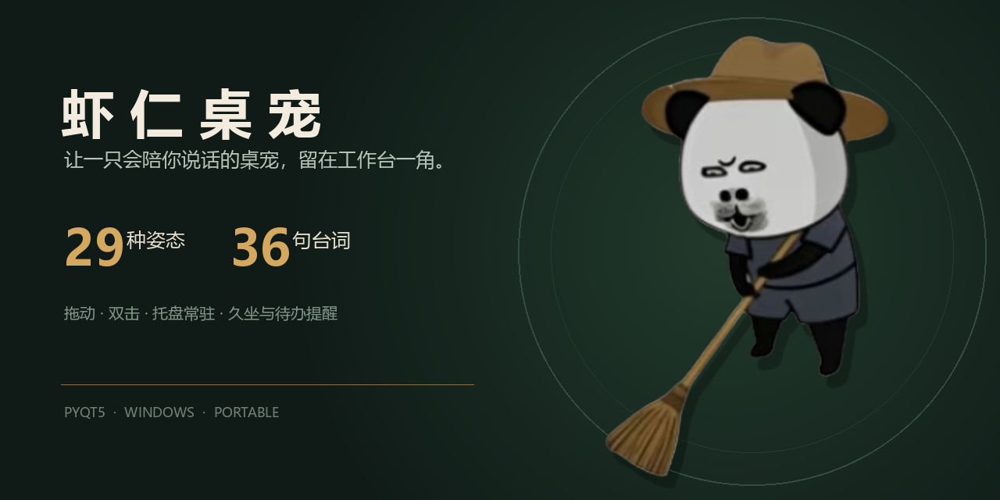

<p align="center">
  
</p>

<h1 align="center">虾仁桌宠</h1>

<p align="center">
  一只会换姿态、会说话、会提醒你照顾自己的 Windows 桌面宠物。
</p>

<p align="center">
  
  
  
  
</p>

## 关于项目

虾仁桌宠是一个本地运行的桌面互动应用。它使用透明窗口常驻桌面，支持姿态切换、气泡台词、位置记忆、待办提醒、久坐提醒和系统托盘，不依赖云端服务。

项目里的角色图片与台词来自个人创作素材；代码保持轻量，方便替换图片、文案和角色主题。

## 功能

- 29 个独立姿态，自动轮换时保持 35–70 秒的低频节奏
- 36 条台词按顺序轮播，同一轮内不重复
- 拖动窗口后记住位置，换屏或分辨率变化时自动回到可见区域
- 右键切换姿态、缩放、设置久坐提醒和管理每日待办
- 双击角色立即换姿态并说一句话
- 系统托盘隐藏/恢复，退出时保存设置
- 全部数据保存在本地 `data/` 目录

## 快速开始

### 直接运行

需要 Python 3.10 或更高版本：

```powershell
python -m pip install -r requirements.txt
python main.py
```

Windows 用户也可以双击 `run.bat`。脚本会检查 PyQt5，缺少依赖时自动安装。

### 下载便携版

前往仓库的 **Releases** 页面下载 `xiaren-desktop-pet-windows.zip`，解压后运行 `虾仁桌宠.exe`。请保留同目录下的 `assets/` 文件夹。

发布包的 SHA-256 校验值见 [`docs/SHA256SUMS.txt`](docs/SHA256SUMS.txt)。

## 操作

| 操作 | 效果 |
| --- | --- |
| 左键拖动 | 移动桌宠并保存位置 |
| 双击 | 切换下一姿态并播放台词 |
| 右键 | 打开姿态、缩放、提醒与托盘菜单 |
| 托盘单击 | 隐藏后重新显示桌宠 |

## 目录结构

```text
xiaren-desktop-pet/
├── main.py                 # PyQt5 主程序
├── assets/images/          # 角色姿态素材
├── assets/audio/           # 预留音效目录
├── data/settings.example.json
├── scripts/build.ps1       # Windows 便携包构建
├── run.bat
└── .github/workflows/      # Windows 自动构建
```

用户设置会写入 `data/settings.json`，提醒会写入 `data/reminders.json`。这两个运行时文件不会提交到 Git。

## 构建

```powershell
python -m pip install -r requirements-dev.txt
./scripts/build.ps1
```

完成后，便携包位于 `dist/xiaren-desktop-pet-windows.zip`。

## 替换角色

将新的透明 PNG 放入 `assets/images/`。程序按文件名字典序扫描全部图片，不需要修改代码；新增图片会自动加入轮换和菜单。

## 隐私与使用说明

应用无需联网，不上传位置、提醒内容或使用数据。角色名称、图片和相关作品元素的权利归各自权利人所有；本仓库用于个人作品展示与学习，不构成商业授权。

